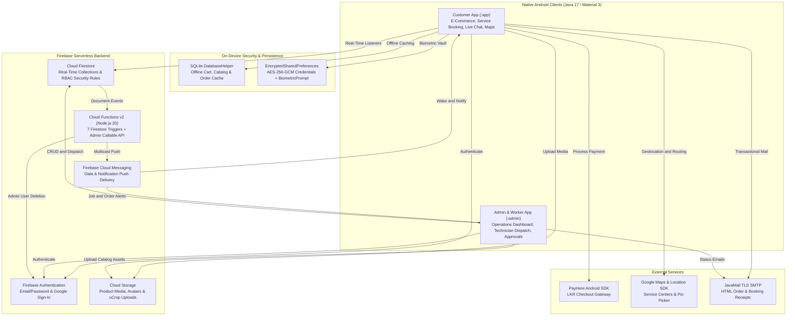
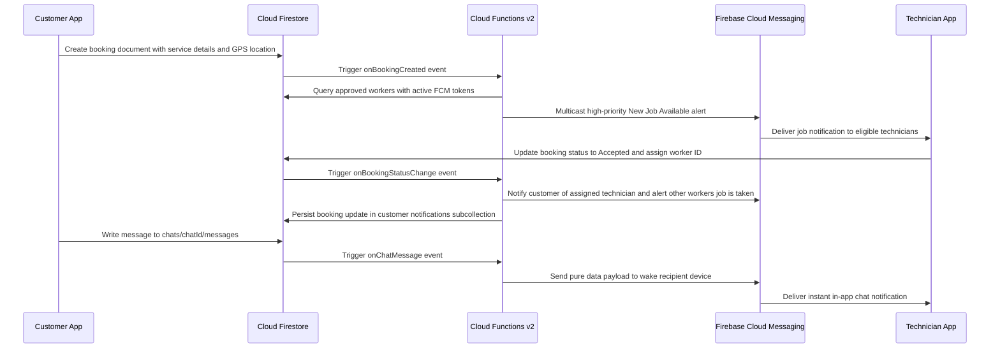
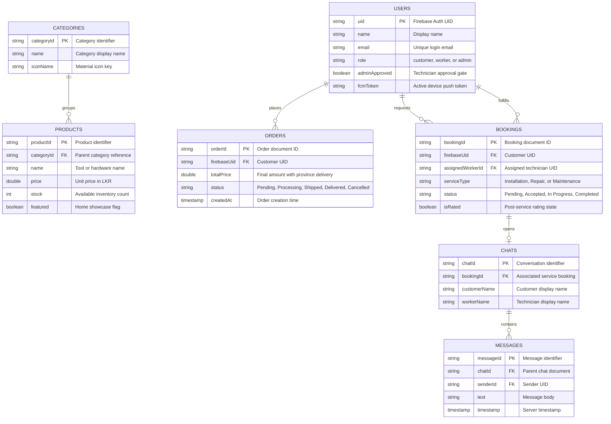

<div align="center">
  

  <h1>LexoraFix</h1>

  <p><strong>Multi-Module Android E-Commerce &amp; On-Demand Home Services Platform</strong><br />
  Dual native Android apps (Customer + Admin/Technician) unified by an event-driven Firebase Cloud Functions v2 backend, real-time Firestore synchronization, PayHere checkout, and RBAC security.</p>

  <p>
    
    
    
    
    
    <a href="LICENSE"></a>
  </p>
</div>

---

## System Architecture

LexoraFix is engineered as a three-tier monorepo combining a **Customer Android application (`:app`)**, an **Admin & Technician Operations application (`:admin`)**, and a **serverless Node.js Firebase Cloud Functions v2 backend (`functions/`)**.



### Real-Time Service Dispatch & Live Chat Flow



### Core Data Model



---

## Core Engineering Highlights

### Multi-Role Android Monorepo (`:app` & `:admin`)
- **Customer Application (`:app`):** 16 activities, 13 fragments, and 14 RecyclerView adapters covering catalog browsing, variant selection, product image sliders & video previews, wishlist, cart, PayHere checkout, province-based dynamic delivery fees, real-time order tracking, GPS service center maps, service booking, worker rating, and live technician chat.
- **Admin & Technician Application (`:admin`):** 19 activities and 13 adapters supporting dual operational personas inside one signed build:
  - **Administrators:** Revenue/order analytics dashboard, catalog/category/variant CRUD with uCrop image cropping, service center geo-management, product review moderation, order fulfillment, worker application approval, user deletion (Firestore + Firebase Auth), and global remote Maintenance Mode toggle.
  - **Field Technicians (Workers):** Self-registration with mandatory admin approval gating (`WorkerPendingActivity`), real-time job pool, status progression (`Pending -> Accepted -> In Progress -> Completed`), and live customer chat with quick-reply templates.

### Security, Persistence & Event-Driven Automation
- **Role-Based Firestore Security Rules (`firestore.rules`):** Enforces `isAdmin()`, `isWorker()`, and owner-scoped subcollection rules (`users/{uid}/orders`, `users/{uid}/bookings`, `users/{uid}/notifications`) alongside Storage rules (`storage.rules`).
- **On-Device Security:** Combines `androidx.security:security-crypto` (`EncryptedSharedPreferences` backed by AES-256-GCM `MasterKey`) with `BiometricPrompt` strong biometric/device-credential authentication.
- **Hybrid Offline + Cloud Persistence:** Pairs live Firestore snapshot listeners with a local SQLite `DatabaseHelper` (8 normalized tables) for responsive cart/catalog state and resilient connectivity handling (`NetworkChangeReceiver`, `BootReceiver`).
- **Cloud Functions v2 (`functions/index.js`):**
  - `onBookingCreated` — multicasts job alerts to all admin-approved technicians.
  - `onBookingStatusChange` — notifies customers on workflow transitions, logs in-app notifications, and alerts other technicians once a job is claimed.
  - `onChatMessage` — resolves participant roles and dispatches high-priority data-only FCM messages to wake target devices reliably.
  - `onOrderCreated` & `onOrderStatusChange` — notifies admins of incoming orders and customers of fulfillment milestones.
  - `onWorkerRegistered` & `onWorkerApproved` — powers the technician onboarding approval pipeline.
  - `deleteUser` (`onCall`) — admin-verified HTTPS callable function that removes accounts cleanly from Firebase Authentication.

---

## Repository Structure

```text
LexoraFix/
├── app/                                # Customer Android application (Java 17)
│   ├── build.gradle.kts                # Module config & BuildConfig secret injection
│   ├── google-services.json.example    # Sanitized Firebase client config template
│   └── src/main/
│       ├── AndroidManifest.xml
│       ├── assets/data.json            # Local seed catalog & service center metadata
│       ├── java/com/lexoratech/lexorafix/
│       │   ├── activities/             # 16 activities (Checkout, Map, Chat, Tracking, etc.)
│       │   ├── adapters/               # 14 RecyclerView & ViewPager2 adapters
│       │   ├── data/                   # FirestoreHelper, DatabaseHelper, SecurePreferencesManager
│       │   ├── fragments/              # 13 UI fragments & bottom sheets
│       │   ├── models/                 # 14 domain models (Lombok-annotated)
│       │   ├── network/                # EmailHelper (JavaMail SMTP), ConnectivityHelper
│       │   ├── notifications/          # NotificationHelper & channels
│       │   ├── receivers/              # BootReceiver, NetworkChangeReceiver
│       │   ├── services/               # FCM, OrderStatus, UserStatus, ReminderScheduler
│       │   └── utils/                  # BiometricHelper, ThemeUtils
│       └── res/                        # 53 layouts, Light/Dark themes, drawables, animations
├── admin/                              # Admin & Technician Android application (Java 17 / Kotlin)
│   ├── build.gradle.kts
│   ├── google-services.json.example
│   └── src/main/
│       ├── AndroidManifest.xml
│       ├── java/com/lexoratech/lexorafix/admin/
│       │   ├── activities/             # 19 activities (AdminDashboard, WorkerDashboard, CRUD)
│       │   ├── adapters/               # 13 management & chat adapters
│       │   ├── network/                # Admin EmailHelper
│       │   ├── notifications/          # AdminNotificationHelper
│       │   ├── services/               # AdminOrderListenerService, FCM
│       │   └── utils/                  # BiometricHelper, ThemeUtils
│       └── res/                        # 33 layouts & Material 3 SaaS card styles
├── functions/                          # Firebase Cloud Functions v2 (Node.js 20)
│   ├── index.js                        # 7 Firestore triggers + 1 Admin callable function
│   ├── seed_delivery.js                # Province delivery-rate Firestore seeder
│   ├── debug.js                        # Diagnostic script for bookings & FCM tokens
│   ├── test_firestore.js               # Notification subcollection inspection utility
│   └── package.json
├── gradle/libs.versions.toml           # Centralized Gradle version catalog
├── firebase.json                       # Firebase CLI deployment targets
├── firestore.rules                     # Role-based Cloud Firestore security rules
├── firestore.indexes.json              # Composite Firestore query indexes
├── storage.rules                       # Firebase Cloud Storage security rules
├── local.properties.example            # Template for PayHere, Maps & SMTP secrets
├── .firebaserc.example                 # Template for Firebase project alias
└── LICENSE                             # MIT License
```

---

## Getting Started

### Prerequisites
- **Android Studio** (Ladybug or newer) with Android SDK 35
- **JDK 17+** (Gradle toolchain configured for Java 17 / Daemon JVM 21)
- **Node.js 20+** and **Firebase CLI** (`npm install -g firebase-tools`)
- A **Firebase project** with Authentication, Cloud Firestore, Cloud Storage, Cloud Messaging, and Cloud Functions enabled
- API keys for **Google Maps Android SDK** and **PayHere** (sandbox or live merchant account)

### 1. Clone the Repository
```bash
git clone https://github.com/theekshana-sudeepa/LexoraFix.git
cd LexoraFix
```

### 2. Configure Environment & Secrets
Copy the sanitized templates and supply your own local credentials (all secret files are gitignored):

```bash
cp local.properties.example local.properties
cp .firebaserc.example .firebaserc
cp app/google-services.json.example app/google-services.json
cp admin/google-services.json.example admin/google-services.json
```

1. Update `local.properties` with your `sdk.dir`, PayHere credentials (`payhere.merchant.id`, `payhere.merchant.secret`, `payhere.sandbox`), `maps.api.key`, and SMTP credentials (`email.sender.address`, `email.app.password`, `admin.email`).
2. Download your real `google-services.json` from the Firebase Console for package IDs `com.lexoratech.lexorafix` (`app/`) and `com.lexoratech.lexorafix.admin` (`admin/`).
3. Set your Firebase project ID inside `.firebaserc`.

### 3. Deploy Firebase Rules, Indexes & Cloud Functions
```bash
firebase login
firebase deploy --only firestore:rules,firestore:indexes,storage

cd functions
npm install
firebase deploy --only functions
```

Optional — seed province-based delivery charges into Firestore (`system/deliveryCharges`):
```bash
export FIREBASE_PROJECT_ID="your-firebase-project-id"
export GOOGLE_APPLICATION_CREDENTIALS="/path/to/serviceAccountKey.json"
node seed_delivery.js
```

### 4. Build & Run Locally
```bash
# Build both Customer (:app) and Admin/Worker (:admin) debug APKs
./gradlew :app:assembleDebug :admin:assembleDebug

# Run JVM unit tests across both modules
./gradlew :app:testDebugUnitTest :admin:testDebugUnitTest
```

Or open the root directory in **Android Studio**, allow Gradle sync to complete, select either the `app` or `admin` run configuration, and deploy to an emulator or physical Android device (API 24+).

---

## License

This project is licensed under the **MIT License** — see the [LICENSE](LICENSE) file for full details.

---

<div align="center">
  <p>Engineered by <strong>Theekshana Sudeepa</strong></p>
  <p>
    <a href="https://www.linkedin.com/in/theekshana-sudeepa/">LinkedIn</a> ·
    <a href="https://github.com/theekshana-sudeepa">GitHub</a> ·
    <a href="https://lexoratech.com">LexoraTech</a>
  </p>
</div>
